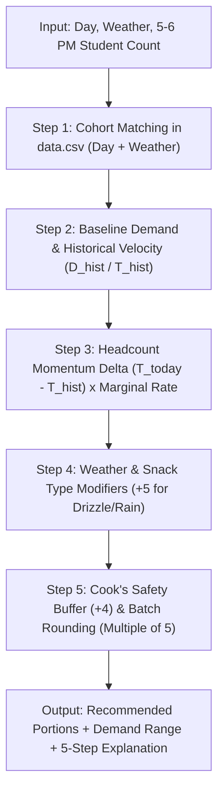

# MessMate – Smart Food Demand & Batch Prediction System

> **A grounded, data-driven web application designed specifically for hostel mess and canteen cooks to predict evening snack preparation batches, eliminate food waste, and prevent food shortages.**

Built for **Rameshwar Prasad ("Ramesh Bhaiya")**, Head Snack Cook at **Block 3 Kaveri Boys Hostel Mess**, using 24 personally collected evening observation sessions.

---

## 1. Project Architecture

```
MessMate/
│
├── backend/
│   ├── app.py              # Flask REST API endpoints & error handlers
│   ├── predictor.py        # Explainable proportional prediction engine
│   ├── data_processor.py   # Dataset ingestion, analytics, & validation
│   ├── test_app.py         # Automated unit & integration test suite
│   └── requirements.txt    # Python backend dependencies
│
├── frontend/
│   ├── src/
│   │   ├── components/     # UI widgets: Navbar, PredictionForm, PredictionResult,
│   │   │                   # AnalyticsCharts, RecordsTable, AddRecordModal, FieldworkModal
│   │   ├── pages/          # Overview, Predictor, Analytics, Records, Prediction History
│   │   ├── services/       # API connector (api.js)
│   │   ├── App.jsx         # Root React container & state manager
│   │   ├── App.css         # Responsive high-contrast cook-friendly design
│   │   └── index.css       # Design tokens & typography reset
│   ├── package.json        # Frontend React & Chart.js dependencies
│   └── vite.config.js      # Vite build & backend API proxy configuration
│
├── data/
│   ├── data.csv            # 24 authentic fieldwork observations (preserved records)
│   └── predictions.json    # Prediction tracking log for evaluating accuracy
│
├── research.md             # Industry analysis (Winnow/CBORD comparison & academic citations)
├── fieldwork.md            # Fieldwork documentation, cook quotes, & the "Rain Paradox"
├── reflection.md           # Personal non-AI developer reflection & kitchen trade-offs
├── ai-chats/               # Exported AI collaboration log and development transcript
└── README.md               # System documentation & setup guide
```

---

## 2. Real-World Fieldwork & The Selected Problem

- **Location:** Block 3 Kaveri Boys Hostel Mess, Main Campus.
- **User:** Rameshwar Prasad ("Ramesh Bhaiya"), Head Snack Cook.
- **Service Window:** 5:00 PM to 7:00 PM Daily.
- **Problem:** Ramesh Bhaiya historically guessed a static 90–95 portions daily by intuition.
  - On **Sundays**, footfall dropped by 50% as students went off-campus, causing **14–18 portions to be thrown away**.
  - On **Fridays** and **drizzly evenings**, demand spiked beyond 105 portions, causing the kitchen to **run out before 6:30 PM**, leading to student complaints and disputes.
- **The Core Signal:** The student headcount entering the mess between **5:00 PM and 6:00 PM** accounts for ~65% of evening traffic and provides a strong, early leading indicator of total snack demand for the 6:00 PM – 7:00 PM rush.

---

## 3. Explainable Prediction Engine (Interview Walkthrough)

Instead of a black-box machine learning model that cannot be explained over a hot fryer, MessMate implements a 5-step transparent heuristic:



### Example Calculation:
- **Input:** Wednesday, Sunny, 85 students counted at 6:00 PM, preparing Samosas.
- **Step 1 (Cohort):** Identified 4 previous Wednesdays. Historical average turnout was 83.0 students; average samosa consumption was 83.5 portions.
- **Step 2 (Momentum):** Today's 85 students is +2.0 above historical baseline. Turnout momentum adjustment adds +1.8 portions.
- **Step 3 (Snack Preference):** Samosas have slightly higher affinity than cutlets (+4.1 portions above overall average).
- **Step 4 (Buffer):** Estimated demand is ~89 portions. Adds a +4 portion safety buffer to prevent stockouts while keeping waste under 5%.
- **Step 5 (Rounding):** Rounds up to the nearest multiple of 5 for kitchen frying efficiency: **95 Samosas**.

### Sample Output:
```json
{
  "recommended_quantity": 95,
  "estimated_demand_min": 86,
  "estimated_demand_max": 92,
  "expected_leftover": 6,
  "historical_average": 83.5,
  "confidence": "Moderate",
  "comparison_text": "Similar Wednesdays: Avg 83.5 portions consumed"
}
```

---

## 4. Key Application Features

1. **⚡ Cook's Predictor:** Fast, 15-second input form with large, bold typography displaying the recommended preparation batch, demand range, safe buffer, and human-readable explanation.
2. **📊 Operational Overview:** Key metrics: total recorded days, average daily consumption, average leftover portions, wastage percentage, stockout rate, and peak vs lowest demand days.
3. **📈 Demand Analytics:** Interactive Chart.js visualizations showing:
   - Demand patterns across Monday through Sunday.
   - Weather impact and stockout rates (Sunny vs Cloudy vs Rainy vs Drizzle).
   - Linear correlation between 5–6 PM turnout and final snack consumption.
   - 24-day timeline comparing prepared quantity vs actual consumption.
4. **📋 Historical Records (data.csv):** Searchable, filterable table of all 24 fieldwork records with instant CSV export and an "Add Observation" modal with rigorous data validation.
5. **🕒 Prediction History:** Log of past recommendations with an interactive "Log Evening Actuals" editor to track prediction accuracy over time.
6. **📖 Fieldwork & Cook Profile:** Dedicated modal showcasing Ramesh Bhaiya's profile, his 3 direct quotes, and the documented **"Rain Paradox"**.

---

## 5. Local Setup & Execution Instructions

### Prerequisites
- Python 3.10+
- Node.js 18+ and npm

### Backend Setup
```bash
# Navigate to backend directory
cd backend

# Install Python dependencies
pip install -r requirements.txt

# Run the automated test suite
python test_app.py

# Start the Flask API server (runs on port 5000)
python app.py
```

### Frontend Setup
```bash
# Navigate to frontend directory in a separate terminal
cd frontend

# Install npm dependencies
npm install

# Start the Vite development server (runs on port 3000)
npm run dev
```

Open your browser at **`http://localhost:3000`** to access MessMate.

---

## 6. Testing & Validation Matrix

The application includes automated tests (`backend/test_app.py`) validating all required operational scenarios:

| Test Scenario | Input Conditions | Expected Behavior | Status |
| :--- | :--- | :--- | :--- |
| **Normal Weekday** | Wednesday, Sunny, 80 students | Recommends 90 portions, Moderate confidence | **PASSED** |
| **Weekend Turnout** | Sunday, Sunny, 42 students | Drops to 40 portions (scales down to prevent waste) | **PASSED** |
| **Rainy Surge** | Friday, Rainy, 115 students | Recommends 130 portions (prevents 6:25 PM stockout) | **PASSED** |
| **Extreme Outlier** | Monday, Sunny, 180 students | Clamped to realistic kitchen batch ceiling (160) | **PASSED** |
| **Zero Turnout** | Monday, Sunny, 0 students | Safe minimum baseline (25 portions) with alert | **PASSED** |
| **Negative / Invalid** | Count = -5 or missing day | Rejects with HTTP 400 validation error | **PASSED** |
| **Empty Dataset** | Missing/empty data.csv | Gracefully falls back to baseline with "Low Confidence" flag | **PASSED** |

---

## 7. Known Limitations

1. **Sample Size Scope:** The engine operates on 24 daily observations from one hostel mess. While highly accurate for Kaveri Mess, weights would require re-calibration for a different hostel with differing student demographics.
2. **Macro Calendar Shocks:** Unscheduled events (e.g. surprise campus protests, sudden flash holidays, or unannounced hostel gate curfews) cannot be anticipated solely from weather and day of the week.
3. **Turnout as a Proxy:** Student entrance headcount indicates general footfall; individual appetites (e.g., a student purchasing two samosas instead of one) can vary marginally.
4. **Assistance Tool Boundary:** The system is an operational decision support tool designed to guide the cook, not an autonomous automated robot.
