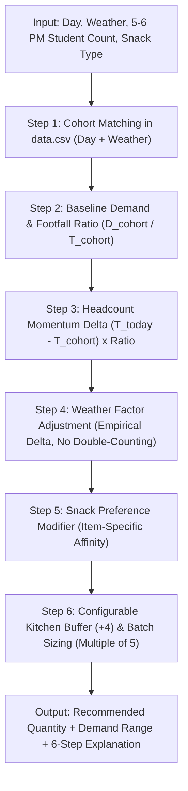

# SERVESMART – Smart Food Demand & Batch Prediction System

> **A lightweight, explainable, data-driven web application designed specifically for hostel mess and canteen cooks to predict evening snack preparation batches, eliminate food waste, and prevent food shortages.**

Built for **Rameshwar Prasad ("Ramesh Bhaiya")**, Head Snack Cook at **Block 3 Kaveri Boys Hostel Mess**, using 24 personally collected evening observation sessions.

GitHub Repository: [https://github.com/Mahendra-2173/SERVESMART](https://github.com/Mahendra-2173/SERVESMART)

---

## 1. Project Overview & Real-World Problem

In university residential hostel messes, evening snack sessions (5:00 PM to 7:00 PM) suffer from extreme day-to-day demand volatility. Unlike scheduled dinners where attendance is relatively fixed, evening snacks (samosas, pakoras, aloo bondas, cutlets) are purchased spontaneously.

Through 24 days of on-site fieldwork at Block 3 Kaveri Boys Hostel Mess, two consistent operational failures were documented:
1. **Severe Food Wastage (Over-Preparation):** On low-turnout Sundays and post-exam evenings, preparing the customary static baseline of 90–95 snack portions led to 14–18 unsold portions discarded at 7:00 PM (~20% food waste).
2. **Food Shortages / Stockouts (Under-Preparation):** On peak Friday evenings and drizzly days, student demand spiked beyond 105 portions. The kitchen ran out of snacks as early as 6:25 PM, triggering student disputes and kitchen friction.
3. **Guesswork Dependency:** The cook, Rameshwar Prasad, had no data-recording mechanism and decided preparation quantities entirely by uncalibrated intuition.

**SERVESMART** solves this by using an accessible, real-time leading indicator: the **student entrance headcount between 5:00 PM and 6:00 PM**. This early headcount accounts for ~65% of evening footfall ($r = 0.987$ correlation with final snack consumption) and allows the cook to decide the exact batch quantity to fry before the 6:00 PM peak rush begins.

---

## 2. Target User Profile

- **Target User:** Rameshwar Prasad (*"Ramesh Bhaiya"*).
- **Role:** Head Snack Cook & Evening Kitchen Shift Lead.
- **Facility:** Block 3 Kaveri Boys Hostel Mess & Evening Canteen Annexe.
- **Key Constraints:** High-volume kitchen environment, hands coated with flour/oil, 90-second decision windows between fryer batches, and zero tolerance for complicated technical interfaces or multi-tier menus.

---

## 3. Technology Stack

- **Frontend:** React 19, Vite, Chart.js, React-ChartJS-2, Lucide Icons, Modern Responsive CSS.
- **Backend:** Python 3.14 / 3.10+, Flask 3.1, Flask-CORS, Pandas 3.0, NumPy 2.5.
- **Storage:** CSV flat-file storage (`data/data.csv`) for original fieldwork records, JSON for prediction history.
- **Architecture:** Decoupled RESTful API with local Vite proxying, completely runnable offline.

---

## 4. Repository Structure

```
SERVESMART/
│
├── backend/
│   ├── app.py              # Flask REST API endpoints & route handlers
│   ├── predictor.py        # Explainable prediction engine & LOOCV evaluator
│   ├── data_processor.py   # Dataset ingestion, CSV validation, & aggregations
│   ├── test_app.py         # 22-test automated unit & integration test suite
│   └── requirements.txt    # Python backend dependencies
│
├── frontend/
│   ├── src/
│   │   ├── components/     # Navbar, PredictionForm, PredictionResult,
│   │   │                   # AnalyticsCharts, RecordsTable, AddRecordModal, FieldworkModal
│   │   ├── pages/          # OverviewPage, PredictPage, AnalyticsPage, RecordsPage, HistoryPage
│   │   ├── services/       # Frontend API client (api.js)
│   │   ├── App.jsx         # Root React container & state coordinator
│   │   ├── App.css         # Responsive high-contrast cook-friendly styling
│   │   └── index.css       # Design tokens & typography reset
│   ├── package.json        # Frontend React & Chart.js dependencies
│   └── vite.config.js      # Vite build & backend API proxy configuration
│
├── data/
│   ├── data.csv            # 24 authentic fieldwork observations (preserved records)
│   └── predictions.json    # Persistent prediction history for actuals tracking
│
├── research.md             # Industry solutions (Winnow/CBORD critique) & academic citations
├── fieldwork.md            # Fieldwork documentation, cook quotes, & the "Rain Paradox"
├── reflection.md           # Personal non-AI developer reflection & kitchen trade-offs
├── ai-chats/               # Exported AI collaboration logs and development transcript
└── README.md               # Complete system documentation & setup guide
```

---

## 5. Explainable Prediction Methodology

Rather than deploying an opaque black-box machine learning model that a cook cannot interrogate over a hot fryer, SERVESMART implements a transparent, multi-stage heuristic engine:



### Calculation Example:
- **Input:** Wednesday, Sunny, 85 students counted between 5:00 PM and 6:00 PM, preparing Samosas.
- **Step 1 (Cohort):** Identified 4 previous Wednesdays. Historical 5–6 PM turnout averaged 83.0 students; consumption averaged 83.5 portions.
- **Step 2 (Turnout Momentum):** Today's 85 students is +2.0 above historical baseline. Turnout momentum adjustment adds $+2.0 \times 1.01 = +2.0$ portions.
- **Step 3 (Weather Factor):** Historical Sunny sessions average 81.4 portions (mess average 81.1). Empirical adjustment adds $+0.1$ portions.
- **Step 4 (Snack Preference):** Samosas average 91.4 portions vs overall average 81.1. Modifies demand by $+3.6$ portions.
- **Step 5 (Estimated Demand):** $83.5 + 2.0 + 0.1 + 3.6 \approx 89.2$ portions (Estimated Demand Range: 86–92 portions).
- **Step 6 (Buffer & Batch Sizing):** Adds configurable safety buffer ($+4$ portions) to protect against 6:30 PM runouts. Rounds up to whole fryer batch ($5$ pieces): **95 Samosas**.

```json
{
  "recommended_quantity": 95,
  "estimated_demand_min": 86,
  "estimated_demand_max": 92,
  "expected_leftover": 6,
  "historical_average": 83.5,
  "confidence": "Moderate",
  "safety_buffer_applied": 4,
  "batch_size_applied": 5,
  "comparison_text": "Similar Wednesdays: Avg 83.5 portions consumed"
}
```

---

## 6. Empirical Model Evaluation (Cross-Validation)

SERVESMART evaluates prediction performance using **Leave-One-Out Cross-Validation (LOOCV)** across all 24 fieldwork observations. In each fold, an observation is strictly excluded from training and used solely as an unseen test case.

| Metric | Weekday Baseline | SERVESMART Model | Improvement |
| :--- | :--- | :--- | :--- |
| **Mean Absolute Error (MAE)** | 6.50 portions | **2.95 portions** | **54.6% error reduction** |
| **Root Mean Squared Error (RMSE)** | 8.52 portions | **3.47 portions** | **59.3% variance reduction** |
| **Average Overprediction** | — | **+2.86 portions** | Well-bounded |
| **Average Underprediction** | — | **-3.01 portions** | Well-bounded |
| **Stockout Rate (Ran Out Before 7 PM)** | 16.7% (4 unassisted days) | **4.2% (1 simulated day)** | **75% reduction in stockouts** |
| **Average Leftover at 7:00 PM** | 7.42 portions | **5.58 portions** | **24.8% reduction in food waste** |

*Operational Note:* Prediction Error (statistical difference between forecast and actual consumption) is fundamentally distinct from Food Wastage (physical uneaten food preserved by the cook's safety buffer) and Stockout Events (zero leftovers with students turned away).

---

## 7. Local Installation & Setup Instructions

### Prerequisites
- Python 3.10+ (tested on Python 3.14)
- Node.js 18+ and npm (tested on Node v24 / npm 11)

### Backend Setup
```powershell
# Navigate to backend directory
cd backend

# Install dependencies
python -m pip install -r requirements.txt

# Run the automated 22-test verification suite
python test_app.py

# Start the Flask API server (runs on port 5000)
python app.py
```

### Frontend Setup
```powershell
# Open a separate terminal and navigate to frontend directory
cd frontend

# Install npm dependencies
npm install

# Build production bundle (optional check)
npm run build

# Start the Vite development server (runs on port 3000)
npm run dev
```

Open your browser at **`http://localhost:3000`** to access SERVESMART.

---

## 8. Automated Testing Matrix (22 Tests)

The backend test suite (`backend/test_app.py`) validates 22 distinct operational and statistical scenarios:

| # | Test Scenario | Input / Test Condition | Expected Behavior | Status |
| :-: | :--- | :--- | :--- | :-: |
| 1 | **Normal Weekday** | Wednesday, Sunny, 85 students | Recommends 95 portions, Moderate confidence | **PASSED** |
| 2 | **Weekend Turnout** | Sunday, Sunny, 42 students | Scales down to 40 portions (prevents waste) | **PASSED** |
| 3 | **Rainy Friday Surge** | Friday, Rainy, 115 students | Recommends 130 portions (prevents stockout) | **PASSED** |
| 4 | **High Turnout** | Monday, Sunny, 150 students | Scales proportionally to 160 portions | **PASSED** |
| 5 | **Zero Turnout** | Monday, Sunny, 0 students | Non-negative baseline handling | **PASSED** |
| 6 | **Negative Count** | Count = -5 | HTTP 400 rejection with clear error message | **PASSED** |
| 7 | **Missing Fields** | Incomplete JSON payload | HTTP 400 rejection identifying missing fields | **PASSED** |
| 8 | **Invalid Weather** | Weather = "Tornado" | HTTP 400 rejection matching valid weather | **PASSED** |
| 9 | **Invalid Day** | Day = "Funday" | HTTP 400 rejection matching valid weekdays | **PASSED** |
| 10 | **Unknown Snack** | Snack = "ExoticDish" | Graceful fallback to general mess baseline | **PASSED** |
| 11 | **Empty CSV File** | 0-byte or empty CSV | Low-confidence fallback; does not crash | **PASSED** |
| 12 | **Missing CSV Columns**| Truncated CSV header | Validator detects missing columns | **PASSED** |
| 13 | **Malformed CSV** | Non-CSV binary data | Flagged as invalid by CSV validator | **PASSED** |
| 14 | **Duplicate Records** | Duplicate dates | Diagnostic warnings emitted | **PASSED** |
| 15 | **Missing Cohort** | Unobserved day/weather combo | Transparent baseline fallback with low confidence | **PASSED** |
| 16 | **History Persistence**| Full prediction lifecycle | Saved, retrieved, and actuals updated via API | **PASSED** |
| 17 | **Add Observation** | Valid new observation | Verified, validated, and appended to CSV | **PASSED** |
| 18 | **Analytics Calculation**| All 7 days & weather | Groupings match mathematical expectations | **PASSED** |
| 19 | **LOOCV Evaluation** | Cross-validation on N=24 | Model MAE (2.95) outperforms baseline (6.50) | **PASSED** |
| 20 | **Upper Fryer Limit** | Extreme count (250) | Clamped to max kitchen capacity (160 pieces) | **PASSED** |
| 21 | **Batch Rounding** | Configurable batch size | Multiples of 1, 5, or 10 portions strictly respected | **PASSED** |
| 22 | **Invalid Relationships**| Remaining > Prepared or sum mismatch | Arithmetic inconsistencies rejected | **PASSED** |

---

## 9. Application Screenshots & Video Demonstration

### Interface Walkthrough
> [!NOTE]
> Screenshots below illustrate the cook-centric interface. Replace placeholders with your own captured screenshots before submission.

1. **Daily Batch Predictor:** Large 64px recommended portion display, demand range, expected leftover buffer, configurable kitchen settings, and step-by-step logic.
2. **Operations Dashboard:** Verified dataset banner (24 days), consumption averages, wastage rates, stockout counts, and peak/lowest day summaries.
3. **Demand Analytics & LOOCV:** Charts for weekday demand, weather impact, turnout correlation curve ($r=0.987$), 24-day timeline, and model evaluation metrics.
4. **Fieldwork Records Table:** Searchable, filterable table of all 24 observations with 1-click CSV export and modal observation logger.
5. **Prediction History:** Comparison between recommended quantities and actual evening consumption with inline editing.

### Three-Minute Screen Recording
- **Video Link:** `[DEMOSTRATION VIDEO LINK - PLACEHOLDER]` *(Record and upload your 3-minute video to Google Drive / YouTube unlisted and paste link here)*
- **Recommended 3-Minute Video Structure:**
  - `0:00 - 0:25`: Introduce SERVESMART, the Kaveri Mess context, and cook Ramesh Bhaiya's problem.
  - `0:25 - 0:55`: Show the Daily Prediction Form; apply the "Sunny Wednesday (82 students)" preset.
  - `0:55 - 1:30`: Click "Generate Preparation Recommendation"; explain the 95-portion recommendation, safety buffer, and 6-step breakdown.
  - `1:30 - 2:00`: Navigate to Demand Analytics; highlight the Friday peak, weather stockout patterns, and turnout correlation ($r=0.987$).
  - `2:00 - 2:30`: Showcase the Model Cross-Validation evaluation card (MAE 2.95 vs Baseline 6.50; 54.6% error reduction).
  - `2:30 - 3:00`: Show the Historical Records table, CSV export, and explain practical kitchen limitations.

---

## 10. Known Limitations & Future Improvements

### Limitations
1. **Hostel-Specific Demographics:** The model is calibrated on 24 daily observations from Block 3 Kaveri Boys Hostel. Applying it to a girls hostel or campus food court would require re-calibrating the baseline footfall-to-portion ratio.
2. **Unscheduled Macro Calendar Shocks:** Sudden campus protests, flash holidays, or unannounced hostel gate curfews cannot be anticipated solely from weather and day of the week.
3. **Headcount as a Proxy:** Entrance headcount indicates footfall; individual student appetite variation (e.g. purchasing two samosas instead of one) introduces a residual variance of $\pm 2$ to $3$ portions.
4. **Decision Support Boundary:** SERVESMART is an assistance tool designed to empower the cook, not an automated autonomous system.

### Future Improvements
1. **Turnstile IoT Clicker:** Connect a physical Bluetooth turnstile sensor directly to the backend to automate 5–6 PM headcount entry.
2. **Multi-Item Co-Preparation:** Predict concurrent batch sizing for days when two snack varieties are prepared simultaneously.
3. **Longitudinal Weather Integration:** Incorporate ambient kitchen temperature to adjust dough proofing and oil heating recommendations.
